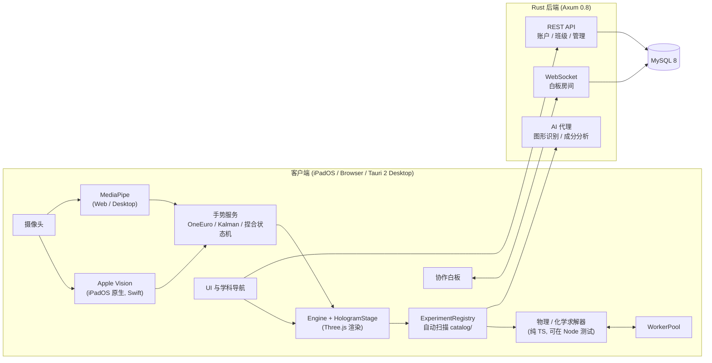

<div align="center">


# HoloGrip

**具身 3D 实验室，让抽象概念触手可及**

面向课堂的开源虚拟实验平台：隔空手势操控 3D 器材，不碰任何共用键鼠与屏幕

*An open-source, touch-free 3D virtual laboratory for STEM classrooms.*

[](https://github.com/SenorPink0487/HoloGrip-Beta/actions/workflows/ci.yml)
[](LICENSE)


[在线体验](https://hologrip.cn) · [功能](#功能) · [快速开始](#快速开始) · [架构](#系统架构) · [创建你的实验](docs/create-experiment.md) · [参与贡献](CONTRIBUTING.md) · [English](#english)

</div>

---

## 为什么做 HoloGrip

| 课堂里的问题 | HoloGrip 的做法 |
| --- | --- |
| **器材贵、有风险**：光具座、霍尔效应仪很多学校买不起；高压电路、化学反应不敢让学生上手 | 虚拟器材，零采购成本、零安全风险 |
| **只能看、不能做**：现有虚拟实验多为 2D 动画或鼠标拖拽，与真实实验动作无关 | 隔空抓取、倾倒、旋转 3D 器材，动作与真实实验一致 |
| **共用外设不卫生**：机房和多媒体教室的键盘、鼠标、触屏由几百名学生轮流使用，常年难以彻底清洁 | 面向摄像头隔空操作，学生和教师都不接触共用设备 |
| **内容由厂商决定**：闭源产品里，老师想要的实验只能等排期 | 开源、模块化，老师可借助 AI 自行开发实验 |

**为什么是手势识别？** 主要是为了卫生。一节需要轮流上手的实验课，等于让全班把手伸向同一套外设。手势识别只需要设备自带的摄像头，不需要 VR 头显或额外传感器。鼠标与触屏操作同样完整可用，没有摄像头的环境也能正常使用。

## 功能

### 实验目录

**20 个 3D 实验 + 化学实验台**，均由可测试的数值模型实时计算，而非预录动画。

| 学科 | 实验 |
| --- | --- |
| **力学** | 伽利略理想斜面 · 自由落体与牛顿管 · 悬挂法测重心 · 牛顿大炮（轨道力学） · 牛顿第三定律 |
| **光学** | 光的反射与折射 · 光的色散 · 光的衍射（单缝 / 圆孔 / 光栅） · 杨氏双缝干涉 · 光的偏振 |
| **电磁学** | 静电场与电场线叠加 · 霍尔效应与载流子动力学 · 电容器充放电与 RC 过程 · 左右手定则 |
| **热学** | 卡诺热机 · 空气压缩引火仪 · 固体热传导与傅里叶定律 · 气体实验三定律 · 晶体与非晶体相变 |
| **数学** | 立体几何：6 种几何体 · 三点定面截面 · 二面角 · 外接球与内切球 · 表面展开图 · 三视图 · **拍照识题生成 3D 模型** |
| **化学** | 双烧杯混合：沉淀、产气、变色、放热与 pH 实时变化 · 元素周期表 · **自然语言描述物质，AI 分析成分后倒入烧杯** |

### 核心能力

- **双通道手势追踪**：iPadOS 原生端调用 Apple Vision 框架（`VNDetectHumanHandPoseRequest`），由 Neural Engine 硬件加速；浏览器与桌面端使用 MediaPipe Hand Landmarker（主线程 GPU 直连，Web Worker 兜底）。两条通道输出统一的 21 点手部关键点，再经 One Euro 滤波、二维卡尔曼瞄准滤波和双阈值迟滞捏合状态机，得到稳定的空间光标与抓取。
- **算渲分离**：粒子、轨道与光学条纹等重计算在 Worker 池中执行，通过 Transferable 零拷贝回传。核心算法不依赖 DOM，可在 Node 中直接测试。
- **高保真 3D 器材**：基于 Three.js 程序化建模，器材带倒角、滚花旋钮、刻度与游标读数。
- **为课堂演示设计**：3D 视窗内没有弹窗和向导，可一键复位到教案推荐参数。
- **班级实时协作白板**：Rust WebSocket 服务，增量笔迹同步（约 16 ms 一批）、服务端定序、撤销/重做、断线重放与 MySQL 持久化。详见 [docs/whiteboard/realtime.md](docs/whiteboard/realtime.md)。
- **账户与班级**：JWT + Argon2id，教师建班、学生凭邀请码加入，配有管理员控制台。详见 [docs/admin.md](docs/admin.md)。
- **AI 辅助**：服务端代理调用大模型完成题目图形识别与物质成分分析，API 密钥只保存在后端。

## 使用场景

| 课堂中 | 课后 |
| --- | --- |
| 教师用 iPad 或电脑投屏，隔空操作器材，全班观看 | 学生在家用 iPad 或电脑，重做课上演示过的实验 |
| 边调参数边讲规律，抽象概念直接可见 | 自己改参数验证猜想，自主探究 |
| 替代危险或昂贵的实验 | 做立体几何作业时拍题，生成模型辅助理解 |
| 实验与白板推导来回切换，教师建班统一管理 | 化学混合随意试错，没有安全风险 |

**为什么优先适配 iPad**：屏幕足够大，可以多人围观或投屏；前置摄像头配合 Apple Vision 原生手势追踪，延迟低、功耗低；在学校里普及度高。头戴设备价格高、一次只能一人使用且需贴脸佩戴，手机屏幕又太小，难以用于课堂。

## 为什么开源

教育不是一个团队能做完的事。每位老师都最清楚自己的学生卡在哪里，而 AI 编程工具已经大幅降低了写代码的门槛。HoloGrip 的架构就是为此设计的：

- **一个实验就是一个文件夹。** 在 `src/experiments/catalog/` 下新建目录，放入 `meta.ts`（名称与参数）和 `index.ts`（3D 场景与逻辑），系统会自动扫描注册，不需要改动任何其他代码。
- **参数界面自动生成。** 在 `meta.ts` 里声明的参数（滑块、开关、下拉框）会自动出现在控制面板中。
- **可以交给 AI 来写。** 复制一个相近的实验，用自然语言描述想要的教学模型，让 AI 生成和修改代码。完整步骤见 **[用 AI 创建你的第一个实验](docs/create-experiment.md)**。
- **改进会回到社区。** 采用 AGPL-3.0 协议：任何人修改后以网络服务形式提供，都必须公开源代码。一位老师做出的实验，所有老师都能使用。
- **可审计、可自部署。** 物理模型公开可校对；学校可以在自己的服务器上部署，账户、班级与白板数据保存在本校。

## 系统架构



| 层 | 技术 |
| --- | --- |
| 手势追踪 | Apple Vision（Swift 原生桥接，Neural Engine）、MediaPipe Tasks Vision（GPU / Web Worker） |
| 前端 | TypeScript（strict）、Three.js r185、Vite、Web Workers |
| 客户端 | Tauri 2（iPadOS / macOS / Windows / Linux）、浏览器 |
| 后端 | Rust、Axum 0.8（REST + WebSocket）、sqlx + MySQL 8、JWT、Argon2id、lettre（SMTP）、tracing |
| 部署 | Docker Compose、Nginx 反向代理 |
| 质量 | GitHub Actions CI、40+ 个 TypeScript 测试套件、Rust 集成测试、帧率性能门禁 |

工程规范见 [docs/ARCHITECTURE_STANDARDS.md](docs/ARCHITECTURE_STANDARDS.md)。

## 快速开始

### 环境要求

- Node.js **≥ 22.6**（推荐 24，测试依赖 `--experimental-strip-types`）
- 可选：Rust **≥ 1.85**、Docker（运行账户 / 白板 / AI 后端）
- 可选：Xcode 与 Tauri 2 工具链（构建 iPad 或桌面应用）

### 运行前端实验室

```sh
git clone https://github.com/SenorPink0487/HoloGrip-Beta.git
cd HoloGrip-Beta
npm install
npm run dev          # http://localhost:5173
```

所有实验均可离线运行；手势控制需要授予摄像头权限。

### 运行后端（账户、班级白板、AI 功能）

```sh
cp server/.env.example server/.env      # 填写 JWT_SECRET，可选 DEEPSEEK_API_KEY
docker compose -f server/docker-compose.yml up -d   # 启动 MySQL
npm run server                          # http://127.0.0.1:8080，自动执行数据库迁移
```

账户页支持通过绑定邮箱的验证码修改密码。启用发件需在 `server/.env` 填写 `SMTP_HOST`、`SMTP_PORT`、`SMTP_SECURITY`（`tls` 或 `starttls`）、`SMTP_USERNAME`、`SMTP_PASSWORD` 和 `SMTP_FROM`，然后重启后端。腾讯企业邮箱使用 `smtp.exmail.qq.com:465`、`SMTP_SECURITY=tls`，密码填写客户端专用密码。凭据仅保存在服务端；请勿写入前端环境变量或提交到 Git。验证码 10 分钟有效、发送间隔 60 秒，连续输错 5 次后失效；改密成功会撤销所有设备的旧登录。

### 测试与构建

```sh
npm run type-check   # TypeScript 类型检查
npm test             # 全部前端单元 / 集成测试
npm run test:perf    # 帧率性能门禁
cargo test --manifest-path server/Cargo.toml   # 后端测试（需要测试数据库）

npm run build:app    # 生产构建 → dist/
npx tauri build      # 桌面应用
```

### iPad / iOS 原生构建

使用完整 Xcode，并通过 `xcode-select` 选择其开发目录；不要将 `DEVELOPER_DIR` 指向独立的 CommandLineTools。首次构建先运行 `npm run tauri -- ios init`，然后运行：

```sh
npm run tauri -- ios build --debug --target aarch64-sim --no-sign
```

Apple Vision 桥接源码位于 `src-tauri/native_ios/`，由 Cargo 编译为 Swift 静态库并链接。不要将这些 Swift 文件另行复制到生成的 Xcode 应用目标中。如果旧工程的 `src-tauri/gen/apple/Sources/virtuallab/` 下已有 `AppleVisionHandManager.swift` 和 `AppleVisionPlugin.swift` 副本，请移除这两个副本及其 Compile Sources 引用，保留 `native_ios/` 中的源码。

## 目录结构

```text
src/
  core/          引擎、渲染舞台、生命周期、平台桥接
  experiments/   实验注册表与 catalog/（每个实验一个目录：meta.ts + index.ts）
  scene/         各学科 3D 器材网格与交互管理器（mech / optics / em / thermo / math）
  physics/       力学、电磁学、热学数值模型
  chemistry/     化学反应引擎与混合物分析
  vision/        手部追踪（Apple Vision / MediaPipe）与手势识别
  workers/       Worker 池、物理与手势 Worker
  whiteboard/    协作白板客户端
  account/ admin/ ui/ controls/
server/          Rust 后端（routes / auth / migrations / tests）
src-tauri/       Tauri 2 外壳与 Apple Vision 原生桥接（native_ios/）
tests/           前端测试套件
docs/            实验开发指南、架构规范、管理后台、白板协议
```

## 路线图

- [ ] 更多实验：单摆与受迫振动、电磁感应、质谱仪、透镜成像
- [ ] 生物学科
- [ ] 对接课程标准与教材章节
- [ ] 实验模板与面向教师的开发工具
- [ ] 多语言界面（English）
- [ ] 白板多实例水平扩展

欢迎在 [Issues](https://github.com/SenorPink0487/HoloGrip-Beta/issues) 中提出想要的实验。

## 参与贡献

欢迎任何形式的贡献：新实验、物理模型校正、3D 建模、文档与翻译。如果你是老师，想做一个自己课堂用的实验，可以从 [用 AI 创建你的第一个实验](docs/create-experiment.md) 开始；代码规范与提交流程见 [CONTRIBUTING.md](CONTRIBUTING.md)。安全问题请按 [SECURITY.md](SECURITY.md) 私下报告。

## 许可证

HoloGrip 以 [GNU Affero General Public License v3.0](LICENSE) 开源。若你修改本项目并以网络服务形式提供给他人使用，需同样公开修改后的源代码。

第三方组件（Three.js、MediaPipe、Tauri、各开源字体等）遵循其各自许可证。

---

## English

**HoloGrip** is an open-source, touch-free 3D virtual laboratory for STEM classrooms. Teachers and students manipulate high-fidelity lab apparatus with **bare-hand gestures** captured by the device camera. No VR headset is required, and nobody touches a shared keyboard, mouse or screen.

**Why gestures? Hygiene.** In school computer labs and multimedia classrooms, keyboards, mice and touchscreens are shared by hundreds of students for years and are rarely cleaned thoroughly. HoloGrip lets everyone grab, pour and rotate apparatus in mid-air. Mouse and touch input remain fully supported.

- **20 3D experiments plus a chemistry bench** across mechanics, optics, electromagnetism, thermodynamics, solid geometry and chemistry. Each experiment is computed in real time from a tested numerical model, not played back as an animation.
- **Dual-path hand tracking**: Apple Vision (Neural Engine) on iPadOS via a native Swift bridge, MediaPipe on web and desktop. Both paths feed One Euro and Kalman filtering and a hysteresis pinch state machine.
- **AI-assisted content**: photograph a solid-geometry problem to get an interactive 3D model; describe a substance in plain language and pour it into a beaker.
- **Built to be extended by teachers**: each experiment is a self-contained folder (`meta.ts` + `index.ts`) that is discovered automatically. See [docs/create-experiment.md](docs/create-experiment.md) for building one with an AI coding assistant.
- **Real-time class whiteboard** over a Rust (Axum) WebSocket server with server-ordered operations, undo/redo, gap replay and MySQL persistence.
- **Cross-platform**: iPadOS, browser and desktop via Tauri 2.

```sh
npm install && npm run dev   # frontend lab at http://localhost:5173
npm test                     # run the test suites
```

Licensed under **AGPL-3.0**. Contributions are welcome. See [CONTRIBUTING.md](CONTRIBUTING.md).
