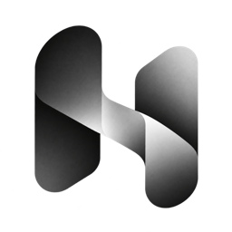
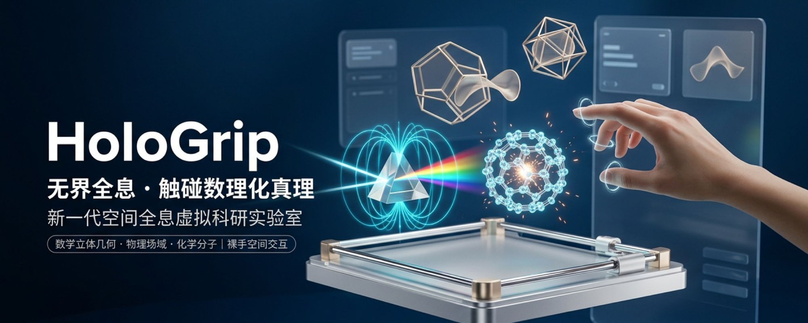
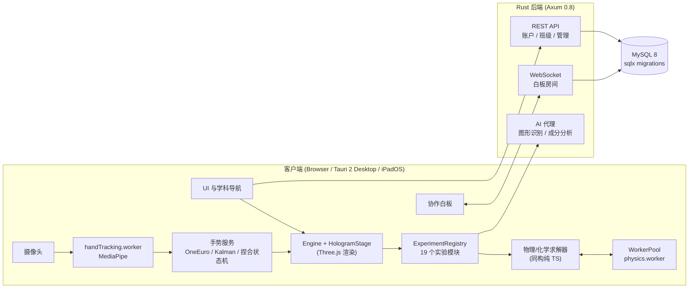

<div align="center">



# HoloGrip

**面向课堂的开源 3D 全息虚拟实验室 —— 裸手手势操控的数学、物理、化学交互实验平台**

*An open-source, gesture-driven 3D holographic virtual laboratory for STEM classrooms.*

[](LICENSE)


[在线体验 hologrip.cn](https://hologrip.cn) · [功能特性](#功能特性) · [快速开始](#快速开始) · [架构](#系统架构) · [参与贡献](CONTRIBUTING.md) · [English](#english)



</div>

---

## 为什么做 HoloGrip

很多学校缺少昂贵或危险的实验器材（激光光具座、霍尔效应仪、绝热压缩点火器……），而现有的虚拟实验软件往往是 2D 动画、闭源收费，或只能在特定设备上运行。

HoloGrip 的目标是：**让任何一块教室大屏、一台电脑或一台 iPad，都能变成一间可以“伸手去做”的高保真物理/化学实验室。**

- **真实物理求解，而非预录动画** —— 每个实验都由可测试的数值模型驱动（光学衍射/干涉强度分布、RC 充放电、轨道力学、绝热压缩、热传导、相变潜热等）。
- **裸手直接操控** —— 基于摄像头的手部追踪，用“捏合”手势抓取、拖动、旋转 3D 器材，无需 VR 头显。
- **为教师演示而设计** —— 纯演示工具定位，无答题打分、无弹窗向导，3D 视窗始终干净；一键复位到教案推荐参数。
- **跨平台** —— 同一套代码运行在浏览器、桌面端（Tauri 2）与 iPadOS。

## 功能特性

### 实验目录（19 个实验，持续增加）

| 学科 | 实验 |
| --- | --- |
| **力学** | 伽利略理想斜面 · 自由落体与牛顿管 · 悬挂法测重心 · 牛顿大炮（天体轨道力学）· 牛顿第三定律双测力计对拉 |
| **光学** | 光的反射与折射 · 光的色散（三棱镜）· 光的衍射（单缝 / 圆孔 / 光栅）· 杨氏双缝干涉 · 光的偏振与双折射 |
| **电磁学** | 静电场与电场线叠加 · 霍尔效应与载流子动力学 · 电容器充放电与 RC 过程（含实时示波窗口） |
| **热学** | 理想气体与分子运动论 · 卡诺热机与循环效率 · 热传导与傅里叶定律 · 物态相变与潜热曲线 · 气体绝热压缩点火 |
| **数学** | 立体几何：拍照识别题目图形 → 自动生成可旋转、可作辅助面的 3D 模型 |
| **化学** | 双烧杯混合与反应特效 · 交互式元素周期表 · 自然语言描述物质 → 成分分析并倒入烧杯 |

### 核心能力

- **手势交互引擎**：MediaPipe Hand Landmarker 在 Web Worker 中运行，配合 One Euro 滤波、二维卡尔曼瞄准滤波与双阈值迟滞捏合状态机，实现稳定、低抖动的空间光标与抓取。
- **算渲分离的物理计算**：大规模粒子（分子运动、N 体轨道）与光学条纹解算在 Worker 池中执行，通过 Transferable 零拷贝回传；无 Worker 环境下自动回退为同步计算，保证 Node 中可测。
- **高保真 3D 器材**：基于 Three.js 程序化建模的光具座、测力计、示波屏、活塞缸等，带倒角、滚花旋钮、刻度与游标读数。
- **班级实时协作白板**：Rust WebSocket 服务，增量笔迹同步（约 16ms 一批）、服务端定序、撤销/重做、断线重放与 MySQL 原子持久化。详见 [docs/whiteboard/realtime.md](docs/whiteboard/realtime.md)。
- **账户、班级与后台管理**：JWT + Argon2id，教师创建班级、学生邀请码加入，管理员控制台管理用户/会话/权限。详见 [docs/admin.md](docs/admin.md)。
- **AI 辅助**：服务端代理调用大模型完成题目图形识别与物质成分分析，API 密钥只保存在后端。

## 系统架构



| 层 | 技术 |
| --- | --- |
| 前端 | TypeScript（strict）、Three.js、Vite、Web Workers、MediaPipe Tasks Vision |
| 桌面 / 移动端 | Tauri 2（macOS / Windows / Linux / iPadOS） |
| 后端 | Rust、Axum 0.8（含 WebSocket）、sqlx + MySQL、JWT、Argon2id、tracing |
| 部署 | Docker Compose、Nginx 反向代理 |
| 测试 | 40+ 个 Node 原生 TypeScript 测试套件（`node --experimental-strip-types`）、Rust 集成测试、FPS 性能门禁 |

工程规范见 [docs/ARCHITECTURE_STANDARDS.md](docs/ARCHITECTURE_STANDARDS.md)。

## 快速开始

### 环境要求

- Node.js **≥ 22.6**（推荐 24，测试依赖 `--experimental-strip-types`）
- 可选：Rust **≥ 1.80**、Docker（运行账户 / 白板 / AI 后端）
- 可选：Tauri 2 工具链（构建桌面端或 iPad 应用）

### 仅运行前端实验室

```sh
git clone https://github.com/SenorPink0487/HoloGrip-Beta.git
cd HoloGrip-Beta
npm install
npm run dev          # http://localhost:5173
```

所有物理/化学实验均可离线运行；手势控制需要浏览器授予摄像头权限。

### 运行后端（账户、班级白板、AI 功能）

```sh
cp server/.env.example server/.env      # 填写 JWT_SECRET，可选 DEEPSEEK_API_KEY
docker compose -f server/docker-compose.yml up -d   # 启动 MySQL
npm run server                          # http://127.0.0.1:8080，自动执行数据库迁移
```

### 测试与构建

```sh
npm run type-check   # TypeScript 类型检查
npm test             # 全部前端单元 / 集成测试
npm run test:perf    # 帧率性能门禁
cargo test --manifest-path server/Cargo.toml   # 后端测试（需要测试数据库）

npm run build:app    # 生产构建 → dist/
npx tauri build      # 桌面应用
```

### iPad / iOS 原生构建

使用完整 Xcode，并通过 `xcode-select` 选择其开发目录；不要将 `DEVELOPER_DIR` 指向独立的 CommandLineTools。首次构建先运行 `npm run tauri -- ios init`，然后运行：

```sh
npm run tauri -- ios build --debug --target aarch64-sim --no-sign
```

Apple Vision 桥接源码位于 `src-tauri/native_ios/`，由 Cargo 编译为 Swift 静态库并链接。不要将这些 Swift 文件另行复制到生成的 Xcode 应用目标中。如果旧工程的 `src-tauri/gen/apple/Sources/virtuallab/` 下已有 `AppleVisionHandManager.swift` 和 `AppleVisionPlugin.swift` 副本，请移除这两个副本及其 Compile Sources 引用，保留 `native_ios/` 中的源码。

## 目录结构

```text
src/
  core/          引擎、渲染舞台、生命周期
  experiments/   实验注册表与 catalog/（每个实验一个目录：meta.ts + index.ts）
  scene/         各学科 3D 器材网格与交互管理器（mech / optics / em / thermo / math）
  physics/       力学、电磁学数值模型
  chemistry/     化学反应引擎与混合物分析
  vision/        手部追踪与手势识别
  workers/       Worker 池、物理与手势 Worker
  whiteboard/    协作白板客户端
  account/ admin/ ui/ controls/
server/          Rust 后端（routes / auth / migrations / tests）
src-tauri/       Tauri 2 桌面与 iOS 外壳
tests/           前端测试套件
docs/            架构规范、管理后台、白板协议文档
```

## 路线图

- [ ] 更多实验：单摆与受迫振动、电磁感应、质谱仪、透镜成像
- [ ] 实验模块插件化 SDK 与贡献者文档
- [ ] 多语言界面（English）
- [ ] 白板多实例水平扩展
- [ ] WebXR / 头显支持

欢迎在 [Issues](https://github.com/SenorPink0487/HoloGrip-Beta/issues) 中提出想要的实验。

## 参与贡献

欢迎任何形式的贡献 —— 新实验、物理模型校正、3D 建模、文档与翻译。请先阅读 [CONTRIBUTING.md](CONTRIBUTING.md)。安全问题请按 [SECURITY.md](SECURITY.md) 私下报告。

## 许可证

HoloGrip 以 [GNU Affero General Public License v3.0](LICENSE) 开源。若你修改本项目并以网络服务形式提供给他人使用，需同样公开修改后的源代码。

第三方组件（Three.js、MediaPipe、Tauri、各开源字体等）遵循其各自许可证。

---

## English

**HoloGrip** is an open-source 3D holographic virtual laboratory built for classroom demonstration. Teachers and students manipulate high-fidelity lab apparatus with **bare-hand gestures** captured by an ordinary webcam — no VR headset required.

- **19 interactive experiments** across mechanics, optics, electromagnetism, thermodynamics, solid geometry and chemistry, each driven by a tested numerical model rather than canned animation.
- **Gesture engine**: MediaPipe Hand Landmarker in a Web Worker, One Euro + Kalman filtering and a hysteresis pinch state machine.
- **Compute/render decoupling**: heavy simulations run in a worker pool with zero-copy transfers and a synchronous fallback for headless testing.
- **Real-time class whiteboard** over a Rust (Axum) WebSocket server with server-ordered operations, undo/redo, gap replay and MySQL persistence.
- **Cross-platform**: browser, desktop and iPadOS via Tauri 2.

```sh
npm install && npm run dev   # frontend lab at http://localhost:5173
npm test                     # run the test suites
```

Licensed under **AGPL-3.0**. Contributions are welcome — see [CONTRIBUTING.md](CONTRIBUTING.md).
